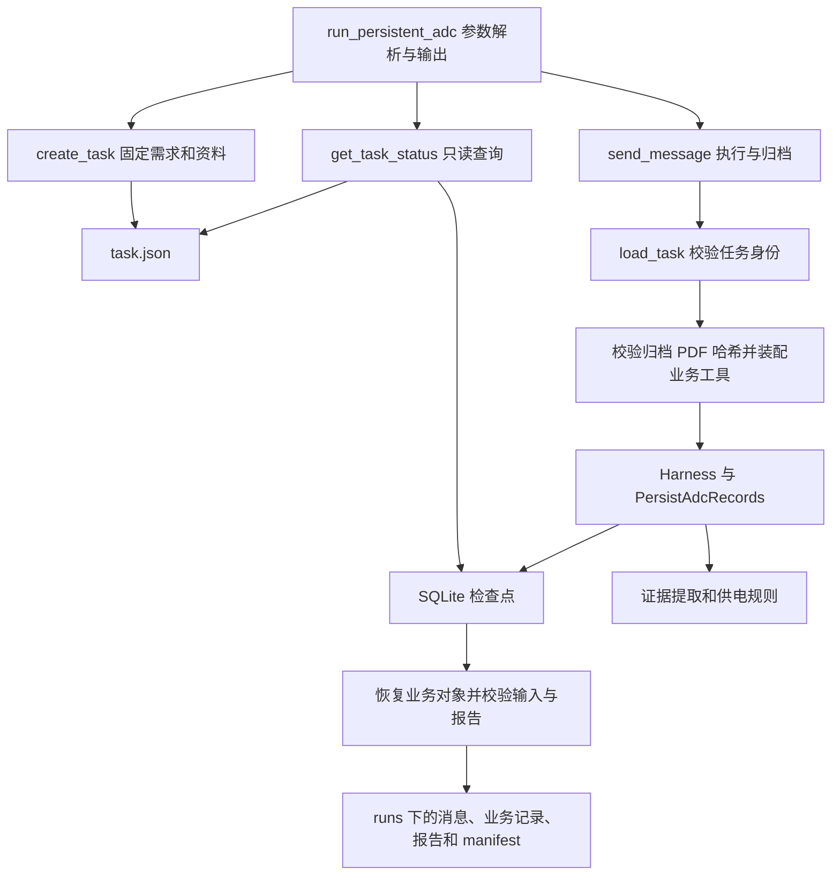

# A1：应用服务与执行边界

2026-10-22。业务范围仍为 ADS1115 指定手册的供电单项核验。



`backend/app/task_service.py` 提供四个普通函数：

| 函数 | 职责 | 是否调用模型 |
| --- | --- | --- |
| `create_task` | 登记 PDF、生成任务 ID、固定需求与 Skill 快照 | 否 |
| `load_task` | 校验任务 ID 与 task/thread 身份，读取元数据 | 否 |
| `get_task_status` | 查询既有检查点和业务记录，不创建 run | 否 |
| `send_message` | 首次执行或向已完成线程追加消息、校验和归档 | 是 |

task 是业务调查对象，thread 是框架状态标识，目前二者一对一且值相同；run 是每次执行的独立归档标识。创建任务只生成固定输入，第一次发送消息才执行核验。首次执行注入需求、资料和 Skill；续聊只追加消息，不覆盖旧文件。已有运行记录但检查点丢失时拒绝重新初始化。

`run_support.py` 保存共用 JSON 归档和成功读取消息统计函数，供旧 ADC 入口与新服务使用，避免应用层依赖脚本。`run_persistent_adc.py` 保留原命令参数；运行 ID 在服务返回后输出，失败运行仍可从任务 runs 目录定位。

查询用 SQLite 只读连接；无 WAL 时使用 immutable 快照以避免生成辅助文件，已有 WAL 时保留正常 WAL 读取语义。该做法限定于当前单任务单进程，不承诺与并发写入者一致的无副作用查询；实现使用锁定版本 SqliteSaver 的初始化标记，升级框架时须复核。

验证（在 backend 中）：

```powershell
.\.venv\Scripts\ruff.exe check app scripts tests
$env:PYTHONDONTWRITEBYTECODE='1'
$testTemp = Join-Path (Resolve-Path ../runtime) ("a1-regression-" + [guid]::NewGuid().ToString("N"))
.\.venv\Scripts\python.exe -B -m pytest -q -p no:cacheprovider --basetemp $testTemp
.\.venv\Scripts\python.exe -B -m scripts.run_persistent_adc --task task-38b52f51fd554a7f82db01bada286a5d --show
```

专用 basetemp 会被 pytest 清空，不得改成资料或真实任务目录。本轮结果为 Ruff 通过、58 passed in 58.03s，历史任务 checkpoint_exists=true，结果 unknown。新增测试实际运行图、工具与 SQLite，模型使用固定响应，PDF 登记使用合成夹具；验证首次执行、查询文件不变、续聊保留输入和报告，以及非法任务 ID 拒绝。原有测试继续覆盖契约、供电规则、工具、权限和跨进程持久化。

未运行真实模型新建与续聊，未新增暂停恢复、审核修订、并发锁或超时重试。下一步为 A2 终端交互及真实事件展示。

复跑修正：用户复用固定 basetemp 时出现 55 passed、3 errors，错误为清理旧目录时 WinError 5，三个相关测试未执行。上面的命令改为每轮使用新 GUID 目录，避开旧目录清理；不修改系统权限。

修正命令后的本轮验证：使用新的 GUID 临时目录，全量离线测试 58 passed in 43.39s。此结果来自 Codex 执行环境；用户终端按新命令复跑的结果仍待确认。
