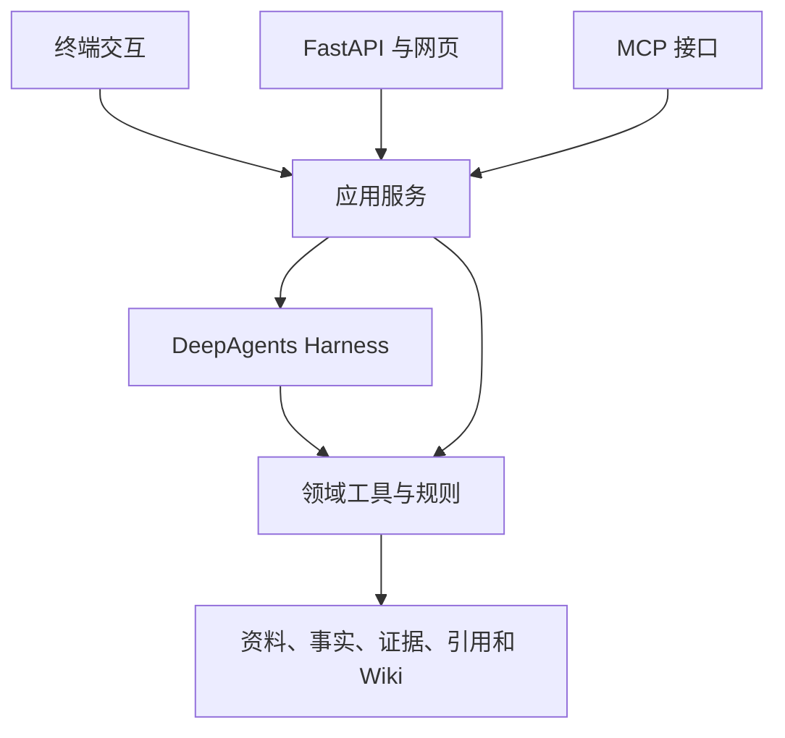

# 面向电子设计的器件选型与证据核验工作台

> 实施计划与本地 Codex 协作要求 · 2026-10-21
>
> 用途：将本文件放到项目根目录，作为本地 Codex 接续开发和教学的入口。本文是实施路线，不是当前功能全部完成的声明。实际代码、依赖锁文件和可复现运行记录优先于聊天中的进度描述。

## 1. 项目目标与开发方式

本项目主要服务于实习求职，同时解决电子设计中的真实问题：面对多份厂家资料，筛选符合需求的 ADC，说明判断依据，并在资料更新后追踪原来的选择是否仍然成立。

核心贡献是：**带适用条件的参数证据、可执行约束核验、资料变化后的选型追踪**。DeepAgents Harness、Skills、Wiki、MCP 都围绕这条业务流程服务。

开发必须采用“边指导、边实现、边验证”的方式。用户需要理解每次代码变化的原因、数据如何流动、结论怎样得到验证，最终能自己讲清项目，而不只是拿到一个生成的代码库。

每轮只完成当前阶段的一个可验收小目标。不要一次生成整个系统，也不要只给方案、伪代码或“请让其他 Codex 实现”的占位内容。

## 2. 产品边界与代表性任务

第一版限定 ADC，先从 2～3 个具体型号形成可靠闭环，再扩展至 10～20 个型号。由用户导入官方数据手册、应用说明、勘误和变更通知。价格、库存和自动全网采集不作为第一版前置要求。

代表性需求：

> 3.3 V 供电，四路模拟输入，I²C 接口，至少 12 位，每路每秒至少 1000 个有效结果；优先便于焊接的封装。从已导入的候选资料中筛选并给出依据。

这是用于检验系统行为的需求示例，不代表某款实际 ADC 能够满足。输入范围、是否需要同时采样等信息缺失时，可以先开展条件性筛选，但不得宣布“完全适用”。

最终应能完成：

1. 导入并登记资料，保留文档版本和原始文件。
2. 输入需求、确认结构化草稿、选定候选和资料范围。
3. Agent 组织调查，定位资料、提取参数、调用规则并补查。
4. 展示候选对照、逐项判断、排除原因、原文与未解决问题。
5. 将可追溯的知识组织成器件 Wiki。
6. 导入新版资料，定位受影响的事实、Wiki 和历史选择，发起复核。

## 3. 交接时的已知环境与进度

### 3.1 环境约定

- 本地根目录：`D:\Mixed_language_project\component-selection-workbench`。
- 后端目录：上述根目录下的 `backend`。
- 用户主要使用 Windows 11、VSCode、PowerShell、uv；本项目使用 Python 3.12。以本地 `.python-version`、`pyproject.toml`、`uv.lock` 为准。
- 已连接 GitHub。不要猜测远程仓库地址，读取 `git remote -v`；不要擅自推送、强制覆盖或清理工作区。
- 模型配置与密钥使用现有 `.env`，不可写入源码、日志、文档或提交记录。
- `runtime` 在根目录下，保存本地资料和运行产物，通常已被 Git 忽略；不要批量删除。
- 聊天记录提及的版本包括 DeepAgents 0.7.22、LangGraph 1.2.13、`langgraph-checkpoint-sqlite` 3.1.2。它们只是交接线索，不是要求重新安装或升级的命令。
- C 盘空间紧张，缓存和运行产物优先留在 D 盘。不要为解决测试问题修改系统权限或要求管理员运行。

### 3.2 已有能力：先核对，再复用

| 能力 | 交接时已知状态 | 接续注意事项 |
| --- | --- | --- |
| 需求、Evidence、ParameterFact、ConstraintResult | 已建立 Pydantic 契约 | 读取完整字段、校验器和现有测试，不能凭本文重建一套 |
| PDF 登记、哈希归档、逐页文本 | 已跑通一份真实手册 | 尚不能视为通用文档解析系统 |
| 供电参数提取 | 当前针对特定手册版本的专用提取 | 保留为可验证基准，逐步扩展 |
| 供电规则 | 已实现，保留待确认状态 | 未审核的事实不会直接产生明确通过结论 |
| Agent、ADC Skill、业务工具 | 已接入 | 先追踪实际调用流程，不重复搭建 |
| 文件访问限制 | 已有实现和专项测试线索 | 区分内置文件工具与自定义工具、宿主程序的权限边界 |
| SQLite 检查点与业务记录恢复 | 已实现 | 已完成任务续聊与执行中断恢复是不同能力 |
| 终端交互、通用资料库、完整 ADC 规则、Wiki、更新追踪、网页、MCP | 待逐步完成 | 若仓库已有新增实现，以现场核对为准 |

可能相关文件：`backend/app/contracts.py`、`documents.py`、`rules.py`、`adc_tools.py`、`file_permissions.py`、`harness.py`、`persistence.py`，以及 `backend/scripts/run_persistent_adc.py`、`backend/skills/`、`backend/tests/`。文件名可能演变，先查实际目录。

### 3.3 已有真实任务记录

- 任务与线程：`task-38b52f51fd554a7f82db01bada286a5d`。
- 已展示的新进程查询结果：`checkpoint_exists: true`，能够读取证据、参数事实与核验结果。
- 已展示的一次续聊运行：`run-0c5d14fcd55c432bb738fbea6846c601`，脚本输出“持久化任务执行通过；供电判定：unknown”。
- 资料版本：`SBAS444E`；型号：`ADS1115`；供电摘录位于 PDF 文件第 4 页；印刷页码尚未登记。
- 参数范围：2～5.5 V；`reviewed=false`；保留 `unknown` 的原因是尚未人工核对参数及适用条件。
- 这证明了已展示路径上的持久化读取和已完成任务续聊；不能据此声称异常退出、工具重试、并发或任意节点恢复均已验证。
- 曾出现 pytest 默认 C 盘临时目录拒绝访问，建议专用 `--basetemp`；是否已经全量通过应查实际输出，不填造测试数量。

## 4. 总体架构与数据责任

### 4.1 共用业务能力，逐步增加入口



应用服务管理资料、任务、消息、审核、报告；Harness 组织调查；业务工具执行受约束的读写与核验。查询任务、登记资料不必都通过模型。前端和 MCP 不另写一套规则。

保留现有技术栈。服务层可以先是少量普通函数，不需要提前建立大量抽象类、依赖注入框架、微服务、消息队列或复杂插件体系。

### 4.2 框架能力与本项目责任

| 层 | 参考或采用什么 | 必须自己实现并验证什么 |
| --- | --- | --- |
| Agent 执行 | DeepAgents 的规划、文件系统、上下文管理、Skills 与工具接入 | 调查范围、工具权限、预算、报告校验与业务流程 |
| 状态持久化 | LangGraph checkpointer、thread、暂停恢复机制 | 业务记录、重放副作用处理、重复请求、版本一致性 |
| 知识组织 | OpenViking LLM Wiki 的实体、概念、方法、比较、分析和引用组织 | 器件页面、事实来源、引用依赖与更新复核 |
| 文档转换 | 现有 PyMuPDF；试验 MarkItDown 等解析器 | 页码映射、表格正确性、条件和脚注、原文定位 |
| 接口复用 | FastAPI、MCP | 调用范围校验、共享业务函数、错误语义与一致性 |

官方文档描述的能力不等于本项目已实现。API 使用方式须匹配本地锁定版本；不要照抄当前最新文档后顺便升级整个依赖树。

### 4.3 五类数据必须区分

| 数据 | 责任 | 不能替代什么 |
| --- | --- | --- |
| 原始 PDF | 版本固定的厂家资料、版式、表格和图形 | 不因转换成功而删除 |
| 提取文本或 Markdown | 供检索、定位和 Agent 阅读的派生产物 | 不是已经审核的参数，更不是 Wiki |
| 参数事实与 Evidence | 数值、单位、条件、来源和适用范围 | 不能只保存一段自然语言总结 |
| Wiki Markdown | 可浏览的知识组织、比较与分析 | 不能自行成为高于原始资料的证据 |
| 检查点、事件与运行归档 | 执行状态、恢复线索、过程证据 | 不能长期代替可查询的业务数据模型 |

关键关系从早期就保留：`文档版本 → 来源片段/Evidence → 参数事实 → 约束结果 → 报告/Wiki`。可以先用简单引用表实现，不需要图数据库。

## 5. 业务正确性的基本约定

### 5.1 需求与结果

- 需求区分硬约束、性能约束、偏好和缺失条件。
- 模型可提出结构化需求草稿；程序校验，用户确认后形成快照。小问题集中澄清，能开展的工作先开展。
- 已归档需求发生实质变化时生成新修订或新任务，不静默修改旧需求。
- 单项结果保留现有四态：满足、不满足、待确认、冲突。内部枚举沿用现有契约，必要时做兼容迁移。
- “尚未核验”和“查过但待确认”在进度上区分，不必为此随意破坏四态结果契约。
- 硬约束明确失败时可排除；全部必要硬约束有充分证据且通过，才能认为技术条件满足；缺失或冲突必须单列。
- 偏好只用于符合条件的候选比较，不能抵消硬约束失败。

### 5.2 参数与证据

- 参数至少关联型号、参数名、值/范围、单位、条件、适用型号/封装、证据与审核状态。
- 区分推荐工作条件、保证值、典型值、绝对最大额定值；不能混用。
- PDF 文件页序使用明确的一基约定，印刷页码另存，未知时保留为空。
- 后续加入原文区域坐标时记录坐标系、页尺寸等约定；旧证据允许只有页级定位，不能伪造坐标。
- OCR、模型提取或转换输出须保留来源与处理方式，不能直接当作人工核对结果。
- 证据绑定具体文档哈希与版本；解析器变化产生新的解析版本，不能无提示替换旧证据对应的内容。
- 不同来源存在分歧时检查日期、型号、条件和资料类型，保留冲突及处理理由，不固定采用“最新一份自动胜出”。

### 5.3 人工审核与历史

- Agent 不得通过工具参数自行把 `reviewed` 设为真。
- 审核保存目标事实、事实版本、审核决定、依据和时间；本地单用户可先用明确的本地身份，不必搭权限平台。
- 审核、参数纠正或新版手册产生新事实修订/审核记录和新核验结果；旧报告引用不变。
- 当前持久化代码若禁止同键事实变化，不得直接撤掉冲突检查。设计最小修订方案，并兼容现有历史任务。

## 6. 实施路线总览

| 里程碑 | 阶段 | 可使用的成果 |
| --- | --- | --- |
| A：终端可用 | A1 应用服务、A2 终端交互、A3 审核与恢复 | 能在终端反复做供电核验、查看证据、退出后继续 |
| B：完整选型 | B1 资料库、B2 检索、B3 多约束多候选、B4 Wiki | 能从多份官方资料比较 ADC 并给出可检查报告 |
| C：变化追踪 | C1 版本差异与影响复核 | 能识别资料变化对旧结论的影响 |
| D：展示交付 | D1 网页、D2 MCP、D3 评测与演示 | 可演示、可复现、可用于实习面试 |

评测、引用关系、运行记录和 `实习.md` 从每个阶段开始积累，不等最后补做。后续可根据实际问题微调阶段顺序，但应说明原因和影响。

## 7. 里程碑 A：先让终端真正可用

### A1. 整理应用服务与执行边界

**目标：** 将脚本中可以复用的创建任务、加载任务、发送消息、查看状态和归档逻辑整理出来，供终端和未来网页使用。

主要工作：

1. 梳理现有脚本、Harness、工具与持久化的调用链，画出一次供电核验的数据流。
2. 提取最小应用服务，现有脚本改为薄入口；不要为了分层重写所有文件。
3. 明确 task、thread、run 的含义：任务是业务调查对象；thread 是图状态的会话标识；run 是一次调用。沿用目前 task 与 thread 一对一映射，暂不扩展多线程任务。
4. 查询状态与实际执行分开。查询不应产生模型调用或额外业务写入。
5. 保留旧任务读取能力；移动代码时不要顺便改变规则判定或数据格式。

交付：服务函数、仍可使用的旧脚本、调用流程说明。

验收：新建任务、查询和续聊路径仍通过；代表性旧任务可读取；不重复导入或覆盖已有任务输入。

当前不做：通用工作流平台、统一插件框架、全库目录迁移。

### A2. 第一版终端交互与可观察事件

**目标：** 用户不再靠拼长命令试验，先在终端使用现有供电能力。

交互范围：

- 中文对话、创建/列出/打开任务、查看状态、查看证据、查看报告、帮助和退出。
- 命令名可采用 `/new`、`/tasks`、`/open`、`/status`、`/evidence`、`/report`，以仓库已有风格为准。
- 创建需求时先支持少量结构化输入或使用现有示例，不假装已经完成自由文本需求理解。
- 普通中文消息发送到当前任务；保留模型输出与程序核验结果之间的区分。
- 明确显示作用域：当前只核验供电，接口、通道数等尚未核验。

技术范围：

- 普通终端交互优先，按需要选择 Rich 等轻量工具；不强制全屏 TUI。
- 从框架/工具真实事件生成“读了哪个页面、调用了哪个工具、结果怎样”的进度，不输出内部思维链或伪进度。
- 事件先统一最小字段：任务、运行、顺序、时间、类型、必要载荷。不要同时造几套事件体系。
- 先展示工具和业务事件，模型 token 流式输出按实际兼容性增加。每次工具开始与结束应可配对，失败有明确原因。
- 普通退出和 Ctrl+C 的行为应明确；在恢复未实现前，不能提示“已保存到任意中断位置”。

验收：启动终端 → 打开/创建任务 → 对话 → 查看证据与报告 → 退出 → 新进程打开同一任务。至少有一次真实模型验证；离线测试只证明控制逻辑。

### A3. 人工审核、暂停与有边界的恢复

**目标：** 从已完成任务续聊，发展为可验证的暂停、审核和失败处理。

分三个小步实现，不在一轮完成：

1. 人工核对供电参数，写入版本化审核记录，触发新的核验；旧结果保留。
2. 通过 LangGraph 的暂停/继续机制等待澄清或审核，在相同 thread 恢复；区分普通新消息和真正 resume。
3. 对选定工具做超时、有限重试、取消和失败恢复，验证进程退出场景。

运行机制：

- 区分运行中、等待输入、完成、失败、取消等业务状态；工具错误不自动等于器件不满足。
- 按任务限制同时执行的写操作；重复请求使用稳定请求标识或唯一约束去重。
- 重要副作用的幂等性在工具/业务层实现。恢复可能重放节点，不能假设检查点保证外部写入“恰好一次”。
- 记录恢复起点、已有产物、是否重试和最终状态；检查点与业务库之间没有自动分布式事务保证，先明确有限恢复边界。
- 增加合理预算：工具次数、整体执行时间或模型调用次数。达到预算返回部分结果和未解决项。

验收：等待审核跨进程恢复；一次可控工具失败后恢复；重复提交不会产生重复有效业务记录；两个任务不串数据。以实际覆盖的故障点说明能力，不宣称通用灾备。

## 8. 里程碑 B：资料、规则与 Wiki 形成闭环

**最终用户体验：** 用户输入“3.3 V 供电、4 路输入、每路至少 100 SPS 的 ADC”一类需求；工作台先让用户确认整理出的约束，再找可能的器件、逐项查原始资料并运行规则，最后给出推荐、排除和待确认候选。每条判断可回到具体文档版本、页码和原文。运行过程产生真实事件，供 D1 网页展示正在使用的工具和进度。

**各步分工：** B1 建立可追溯资料和器件简介；B2 用简介找候选，再到原文找证据；B3 用规则核验和比较；B4 把已核对的知识整理成 Wiki，供下一次调查快速入门。器件简介、Wiki 和 RAG 命中只用于发现线索，不能单独证明器件满足要求。正式判断始终沿着“文档版本 → 原文片段 → 参数事实及条件 → 规则结果 → 报告引用”生成。LLM 负责理解、查找和解释，数值比较与最终状态由程序控制。

### B1. 资料登记、解析与业务数据存储

**目标：** 从单份固定手册扩展为可维护的资料库，让后续检索知道“有哪些器件、资料属于谁、是哪一版、能否定位原文”。本步建立资料基础，不要求已经自动推荐多个器件。

主要工作：

1. 登记厂家、文档类型、关联型号、文档编号/修订、来源、导入时间、哈希、页数与解析状态。
2. 同文件重复导入复用，同系列新版资料另存；文档编号、修订号和文件哈希不要混为同一概念。
3. 用 SQLite 保存可查询的文档、证据、事实、审核、任务和报告元信息，PDF/文本/Markdown 仍可放文件系统。
4. 优先沿用现有记录，不强制一步替换全部 JSON；需要迁移时给出旧数据处理和回退办法。
5. 引入最小解析接口，保留 PyMuPDF 基线，试验 MarkItDown。记录解析器版本、配置和来源页映射。
6. 解析分块保留章节、页面、上下文和表格脚注；空文本、失败、扫描页应有状态，不能冒充成功。
7. 为每个器件建立短小的候选简介：类别、用途、主要特征、关联型号和资料版本。简介可先人工整理或由模型起草后核对，并标明来源与更新时间；不把“适合多通道”等概括当作已经核验的参数事实。
8. 给文档、片段、事实和器件简介稳定标识；从一开始保存来源关联，以便 B2 检索、B3 报告引用和 C1 影响追踪复用。

**MarkItDown 决策：** Wiki 使用 Markdown 有利于浏览、链接和模型阅读，但不意味着所有 PDF 必须由同一转换器处理。拿少量代表性手册比较参数表、双栏、脚注、跨页和关键符号，再决定默认方案。页码与坐标映射由本项目验证；不要假设整份 PDF 转为 Markdown 后自动拥有可靠定位。

当前不要求一次支持全部扫描资料。先覆盖可提取文本的官方 PDF；少量困难页面采用补充解析/视觉核对，并记录人工介入比例与成本。

验收：导入不同类型资料；重复导入无重复有效版本；新旧版本共存；至少两张器件简介能区分候选且能找到绑定资料；关键参数表能抽查回原文；转换错误可见。不能只验收“生成了 .md 文件”。

### B2. 检索、来源定位与按需读取

**目标：** 分两层检索：先从器件简介和结构化标签找值得调查的候选，再在候选的正确资料版本中找参数证据及完整适用条件。RAG 是找线索的手段，不是最终判定器。

主要工作：

- 对用户确认过的需求，先按器件类别、接口、供电等已知标签过滤，再检索简短器件简介；记录为何纳入或排除候选。标签未知时保留候选，不把缺资料误当不满足。
- 在候选范围内做型号、文档类型、版本、章节过滤，以及关键词/全文检索；精确型号、符号、单位和寄存器名要能命中。
- 检索返回片段与来源标识，再提供页面、邻近块或章节读取工具，不把全部手册塞进每次上下文。
- 若精确检索不足，再加入真实 embedding 模型与关键词加语义的混合检索，记录模型、版本和实际收益；不为简历堆叠向量数据库。
- 检索结果同时保留器件、文档版本、页码、章节、片段 ID 和邻近上下文；找不到可靠证据要返回“未找到/待查”，不能由模型补出页码或参数。
- 验证近似型号、共享系列手册、多版本和跨页脚注，不只测最容易命中的标题。
- 从页级定位发展到原文区域定位；不能可靠定位时诚实退回页级。

验收：预先准备少量需求和正确候选/来源，分别记录候选召回与证据召回、错型号和错版本；能按版本过滤，能展开上下文，能从 Evidence 回到原 PDF。用“型号相近但条件不同”的反例检查不会因简介相似而直接推荐。

### B3. 多约束、多候选 ADC 核验与报告

**目标：** 把 B2 找到的候选逐项核验，完成第一轮真正的器件比较，而不只是继续扩展供电演示。

建议迭代顺序：供电 → 接口 → 分辨率 → 通道/输入模式 → 输入范围 → 采样能力 → 封装偏好。每轮新增一个有证据的规则及其报告展示。

主要工作：

1. 模型生成需求草稿，程序校验并让用户确认；缺失条件进入待办问题。
2. 逐步支持 Agent 提出结构化参数草稿，保留证据和条件，再执行字段、引用与审核检查。当前专用提取器继续充当基准。
3. 数值比较、单位换算、条件组合由程序执行，模型组织查找和解释。
4. 固定本次候选和版本范围，支持按器件/约束记录通过、不满足、待确认、证据冲突及排除理由；没有查到参数不等于参数不满足。
5. 对缺失或冲突证据有限补查，结束时保留未解决项。
6. 报告包含需求快照、候选对照、逐项状态、参数、适用条件、原文、版本、页码、排除原因和范围声明。每项结论附可展开的证据链，不能只在报告末尾堆一组资料链接。
7. 报告来自结构化核验结果；模型润色不能改变状态、引用或数值。对缺引用、错引用和结果不一致做程序校验。

采样能力必须区分总转换速率与每通道有效结果速率，检查多路复用、切换、转换模式及稳定时间等相关条件；通道数量不能自动推出同时采样。信息不足时保留待确认，不能机械地用“最大 SPS ÷ 通道数”作为充分证明。

验收：至少 2～3 个型号、明确通过/失败/缺条件/冲突案例；人工答案能逐项对照并点回正确版本的原文；不把供电满足扩写成整体适用。随后再扩展至 10～20 个型号。

### B4. 器件 Wiki、Skills 与知识回写

**目标：** 把零散调查整理为可复用、方便浏览的知识，让下次选型更快找到候选，同时保证来源可追溯。B1 的短简介是入口；Wiki 是经过调查后逐渐丰富的知识页面。

Wiki 页面：

| 类型 | 本项目内容 |
| --- | --- |
| entity | 器件/型号、主要参数、条件、封装与限制 |
| concept | 分辨率、输入范围、有效采样能力等 |
| method | ADC 选型核验方法和检查顺序 |
| comparison | 某组需求下候选的差异 |
| analysis | 一次选型为什么选择、排除或保留待确认 |

采用 Markdown、导航索引、稳定页面标识、互链和来源引用。页面保留引用事实/证据和生成依据，必要时区分资料整理与模型分析。

OpenViking 接入安排：

1. 先读官方 LLM Wiki 示例及其编译流程，把页面类型、来源组织和引用约定落到本项目。
2. 做一个小规模兼容性试验：安装与运行、中文检索、来源标识、页面生成、更新和导出；记录实际环境。
3. 若与当前 Windows/依赖环境兼容且能降低维护成本，接入其资源与编译能力；若阻塞，先保留本地 Markdown 实现并明确后续替换边界。不要宣称“已集成 OpenViking”来代替真实接入证据。

Skills 逐步形成三个：资料导入、ADC 选型、资料变更复核。每个 Skill 说明触发条件、输入、工作步骤、允许的工具、完成标准和错误处理。Skill 负责工作规范，关键约束仍由代码落实。

Agent 可先查器件简介和 Wiki 了解候选，再查原文完成正式核验；Wiki 命中不能跳过原文和规则。回写 Wiki 使用已校验记录，不从聊天自由文本无约束覆盖事实；每页显示依据版本和最近核验状态。

验收：从 Wiki 可导航到原始依据；同一来源重复整理不产生失控重复页；历史选型有需求与报告关联；无来源的总结不能成为正式判定依据。

## 9. 里程碑 C：资料变化与选型追踪

### C1. 版本差异、依赖查询与增量复核

**目标：** 新版资料出现后，回答“变了什么、影响谁、要重查什么”。

分步实现：

1. 建立同系列资料新旧版本关联，保留全部原始版本。
2. 先做内容块/事实差异，再检查型号、单位、条件和脚注变化。
3. 区分事实变化、内容位置变化、纯格式变化和无法确定的变化。文本差异只提供线索，不能自动证明语义无变化。
4. 沿引用关系查询受影响参数、器件简介、Wiki、比较和报告，标记需要复核；旧版结论继续绑定旧版原文。
5. 只重新调查与变化有关的必要范围，形成新的事实/结果及变更说明。
6. 给用户展示“新版改了什么、哪些推荐可能变化、哪些仍不确定”以及前后依据；旧报告不被覆盖。必要的上下文依赖也要纳入影响范围，避免只追踪一个数值字段。

验收集至少包括：数值变化、条件变化、证据移页、无关内容变化、匹配不确定。记录影响漏报/误报、复核质量和成本。

可使用真实修订资料；暂时缺少合适案例时可制作明确标注的测试夹具，但不得冒充厂家发布的新版本。

当前不做：通用语义差异平台、任意文件格式自动无误匹配、无人工介入的历史结论批量改写。

## 10. 里程碑 D：工作台、MCP 与实习交付

### D1. FastAPI 与网页工作台

**目标：** 复用终端已经验证的服务，把 B 阶段的输入、调查过程和带引用的结果放到一个可操作的网页工作台，提供四个产品页面。

| 页面 | 最小可用交互 |
| --- | --- |
| 资料库 | 上传、版本、型号关联、解析状态及错误 |
| 选型任务 | 自然语言输入、结构化需求确认、候选和资料范围确认、启动、真实进度、澄清/审核、取消/继续 |
| 核验结果 | 推荐/排除/待确认候选、逐项结论及条件、排除依据、未解决项、每项引用可展开到 PDF 页级/区域定位 |
| 器件 Wiki | 页面浏览、搜索、互链、历史分析、更新影响 |

先确认仓库现有前端栈；无前端时再选择 React 等常规方案，不为实现页面更换后端。

长任务不把 HTTP 连接当作唯一状态来源。启动返回任务/运行标识，状态可查询，事件可订阅；本地单实例先用受控执行方式，不提前引入队列集群。若采用 SSE，断线后能重查状态或按事件序号补读，不承诺未经验证的可靠重放。

过程区显示后端真实记录的阶段、工具名称、开始/完成/失败状态、耗时和简短结果，例如“筛选候选 → 检索 ADS1115 手册 → 阅读第 4 页 → 核验供电”。不展示模型编造的工具调用或内部思维文本；刷新后能重查已记录事件。结论区的引用由结构化证据生成，点击后打开对应版本的原 PDF，不只跳到 Wiki 摘要。

文件上传落实大小、类型、路径与内容边界；用户文件名不能决定任意落盘位置。失败上传和解析失败有明确反馈。模型把文档当资料读取，不能把资料内指令当作更高优先级命令。

验收：网页完整完成一次需求确认、候选调查、导入/核验、审核和报告查看；能看见真实工具进度，逐项点开引用；与终端业务结果一致；刷新/断线后能找到原任务。终端继续保留，作为调试入口。

### D2. MCP 接口复用

**目标：** 让外部客户端复用稳定业务能力。

先实现并稳定普通 Python 函数，再包装为 MCP：`search_parts`、`read_evidence`、`check_constraints`、`find_impacted_selections`。名称可随现有 API 调整，职责不变。

约束核验工具必须校验证据/事实属于允许任务和资料版本，不能让外部客户端随便传一个“已通过”结果入库。错误采用清楚的结构化返回。

先用一种适合本地演示的传输方式完成客户端验证，之后才按需要扩展。MCP 不是网页后端的必经层，也不是独立业务实现。

验收：真实客户端能够发现和调用工具，同样输入与直接业务函数返回一致，越界标识被拒绝。

### D3. 评测、演示和可复现交付

**目标：** 用证据说明系统解决了什么，以及仍有哪些限制。

- README：目标、范围、环境、启动方式、终端/网页入口、样例、限制。
- 技术说明：架构、核心数据契约、引用依赖、暂停恢复和版本策略。
- 可复现演示：准备样例需求、资料获取方法、运行步骤和预期行为；厂家资料分发遵守其许可，不默认提交 PDF。
- 合理 CI：离线规则/状态测试与 Ruff；真实模型测试显式选择运行，默认 CI 不消耗密钥预算。
- 评测报告与 `实习.md`：数字有来源，失败与人工介入不隐藏。
- 投递前形成一条可演示主流程：导入资料 → 输入并确认需求 → 查看候选与真实调查进度 → 比较逐项结论及原文依据 → 人工审核 → 新版资料影响复核。

无需等待全部高级功能才投递；A 可展示执行骨架，B 可展示业务价值，C 可展示差异化。简历能力描述必须匹配当时完成的里程碑。

## 11. 验证与评测：贯穿所有阶段

### 11.1 三层验证

1. **程序验证：** 契约、规则、引用、状态转换、幂等、版本查询。优先覆盖容易产生错误推荐的边界，不机械复刻实现写测试。
2. **离线 Agent 验证：** 使用可控模型响应检查工具顺序、状态保存、暂停/继续和报告校验；不得把它当作真实模型效果。
3. **真实流程验证：** 少量有代表性的官方资料与真实模型，记录 task/run、文档版本、结果、事件、耗时和失败。

每轮运行相关测试；到里程碑或涉及公共契约时跑必要回归。不要靠不断增加测试数量替代业务正确性，也不要每次文档修改都跑昂贵模型调用。

### 11.2 评测内容与对照

| 类型 | 人工标准答案/记录 | 关注指标 |
| --- | --- | --- |
| 参数题 | 值、单位、条件、型号、来源 | 提取正确率、条件完整性、引用有效性 |
| 候选题 | 需求下应调查和应排除的型号 | 候选召回、漏候选、错型号与错版本 |
| 选型题 | 每项判定和理由 | 误推荐、误排除、待确认/冲突处理 |
| 定位题 | 文件版本、页码和区域 | 引用准确性及回溯成功情况 |
| 更新题 | 哪些旧结论受影响 | 影响漏报/误报、复核后正确性 |
| 执行题 | 故障点及预期状态 | 恢复成功、重复写入、任务隔离 |
| 成本 | 模型、提示、调用、时间 | 同等质量下耗时、token、工具次数 |

建立小规模、独立保存的人工答案；调试集和留出评测集分开。记录评测集规模与分母，不用单个案例宣称普遍正确率。

对照一：相同资料、需求、模型和合理预算下，普通 PDF RAG 与本系统；统一输出要求与评分方式，记录检索/上下文和人工介入差异。

对照二：相同更新案例下，全量重建与增量复核；同时比较质量、影响遗漏、耗时和消耗，不能只看速度。

## 12. 本地 Codex 的协作方式

### 12.1 接手时先了解项目

先查看项目结构、Git 状态、依赖配置、相关源码和测试，以及已有文档和 `实习.md`，了解当前实现与进度。

根据实际仓库判断哪些功能已完成、哪些需要验证，保留用户已有改动和历史数据。无需每次重新检查整个项目，也不必一开始重跑所有真实模型任务。

从当前最合适的小步骤继续。通常先完成 A1，再进入 A2；如果实际进度已经领先，可以调整，并简要说明原因。

### 12.2 边指导、边实现

每轮围绕一个能讲清、能验证的小目标推进，输出可按实际情况组织，不必机械套用固定模板，但应包含以下内容：

1. **本轮做什么**：说明所在阶段、要解决的问题，以及完成后能看到什么效果。
2. **必要知识与修改思路**：先用直观例子讲清关键概念，再说明准备修改哪些文件、为什么修改。
3. **实际修改与代码讲解**：直接在本地实现，重点解释关键函数、数据流和设计选择。
4. **验证与结果**：提供适用的 PowerShell 命令，说明实际运行结果和仍需验证的部分。
5. **变化与用意**：讲清代码相较之前发生了什么变化、解决了什么问题；可用文字或简洁表格。
6. **下一步**：简要说明后续衔接，必要时给一个小操作或理解问题。

已经明确的普通开发工作可以直接推进，不必反复询问是否允许修改。涉及明显扩大范围、破坏已有数据或重要技术取舍时，再与用户讨论。

### 12.3 代码与讲解要求

- 优先复用现有代码和技术栈，避免无关重构。
- 重要函数和类使用中文说明，关键规则、状态变化和恢复逻辑添加必要注释，不要求逐行解释。
- 代码已在本地修改后，重点展示关键代码与变化；新文件或适合完整阅读的小文件可以给出全文。用户要求完整代码时，再完整提供。
- 新增文件时说明路径和用途；需要用户手动操作时，再附 PowerShell 命令。
- 遇到较大的内容，拆成几个可验证的小步骤，避免一次改动过多、讲解跟不上。
- 可以根据需要使用流程图或界面示意，帮助理解，不必每轮都画图。

### 12.4 验证与故障处理

根据改动选择相关检查和测试，必要时再运行完整回归。真实模型调用适量进行，区分程序测试通过与真实业务效果验证。

在 `backend` 目录下，测试命令可参考：

```powershell
uv run python -m pytest tests/test_persistence.py -q --basetemp="../runtime/pytest-temp"
```

需要完整回归时：

```powershell
uv run python -m pytest -q --basetemp="../runtime/pytest-temp"
```

`--basetemp` 必须指向专用测试目录，因为 pytest 会清空该目录，不能指向真实资料或任务目录。

出现错误时，先定位原因，再做必要修改；避免直接大规模升级依赖或删除数据。结果如实说明，未执行或未通过的验证不要写成已经通过。

### 12.5 进度、Git 与实习记录

保持小步修改，保留已有工作。阶段完成后简要记录成果、验证情况和下一步，并给出合适的 Git 提交建议；提交和推送按用户授权执行。

密钥、缓存和运行产物不应误入提交。


## 13. 每阶段的实习记录要求

每完成一个可验收阶段，先汇总实际证据，再直接完成更新实习.md，并同时展示所使用的提示词与改动摘要。

记录不追求百科全书式详解，重点是用户能在面试中讲清：问题、机制、选择、验证和边界。

通用提示词模板：

```text
请结合本阶段实际代码、测试输出和运行产物，更新根目录“实习.md”。
阶段名称：[填写本阶段名称]
实际证据：[填写文件、命令、task/run 或输出路径]

内容包括：
1. 原来的具体问题，以及本阶段实现后的行为变化。
2. 核心调用流程和关键技术机制，解释到我能在面试中讲清。
3. 框架提供什么、项目自己实现什么；为什么选择当前方案。
4. 有代表性的代码变化及其用意，不逐行复制源码。
5. 实际验证的方法、结果和产物；区分离线测试与真实模型验证。
6. 尚未验证和暂不支持的场景，以及合理的下一步。
7. 3 个有深度但不过度刁钻的面试追问及简洁回答。

保留已有内容，消除过时或互相矛盾的描述。
不要编造指标、测试数量或生产级保证，不把规划写成已完成。
如证据不足，明确写“待验证”，不要为了简历效果夸大。
```

简历表述应随真实成果演进。优先写已实现机制和实际评测结果；“准确率提升”“成本下降”等数字只有在公平对照后才能填写。

## 14. 当前明确暂缓的事情

- 第一版不要求多 Agent；单 Agent 流程稳定并证明有并行需求后再讨论。
- 不提前做自由代码执行、复杂长期记忆、动态子 Agent 或企业多租户。
- 不把 Docker、云部署、向量数据库、图数据库当作开工门槛。
- 不承诺任意 PDF、扫描件、图表自动无误理解。
- 不用模型的自评代替独立标准答案，不用增加技术名词代替业务正确性。
- 不要求在编码前锁死全部表结构、API 和 UI。只固定当前所需契约，对后续扩展保留清晰边界。

## 15. 官方参考与使用原则

以下资料于 2026-10-21 核对。它们是实现依据与学习入口；本计划中的阶段划分、业务审核规则和验收标准是项目设计，不代表上游已经提供完整器件选型系统。

| 官方来源 | 主要参考内容 |
| --- | --- |
| [DeepAgents 仓库](https://github.com/langchain-ai/deepagents) | Harness 基础能力和版本实现 |
| [DeepAgents 概览](https://docs.langchain.com/oss/python/deepagents/overview) | 工具、文件系统、上下文、Skills 等能力入口 |
| [LangGraph 持久化](https://docs.langchain.com/oss/python/langgraph/persistence) | checkpointer、thread 状态与跨会话数据的分工 |
| [LangGraph Interrupts](https://docs.langchain.com/oss/python/langgraph/interrupts) | 人工暂停、恢复及重放相关约束 |
| [OpenViking：LLM Wiki 示例](https://docs.openviking.ai/zh/context-compilation/02-llm-wiki) | 来源导入、Wiki 页面类型、互链与编译流程 |
| [MarkItDown 仓库](https://github.com/microsoft/markitdown) | Markdown 转换、格式支持与扩展方式；不替代本项目定位与正确性验证 |
| [Deep Agents 实战](https://github.com/datawhalechina/deepagents-in-action) | 用户已学习的 Harness、文件系统、规划、Skills 等教学材料 |
| [MCP 初学者课程](https://github.com/microsoft/mcp-for-beginners) | 服务端、客户端、工具发现与调用学习入口 |

使用前查本地版本与官方接口；官方资料变化时记录影响，不为追新自动迁移。OpenViking 与 MarkItDown 的采用结果要通过本项目的兼容性和资料质量试验决定。


